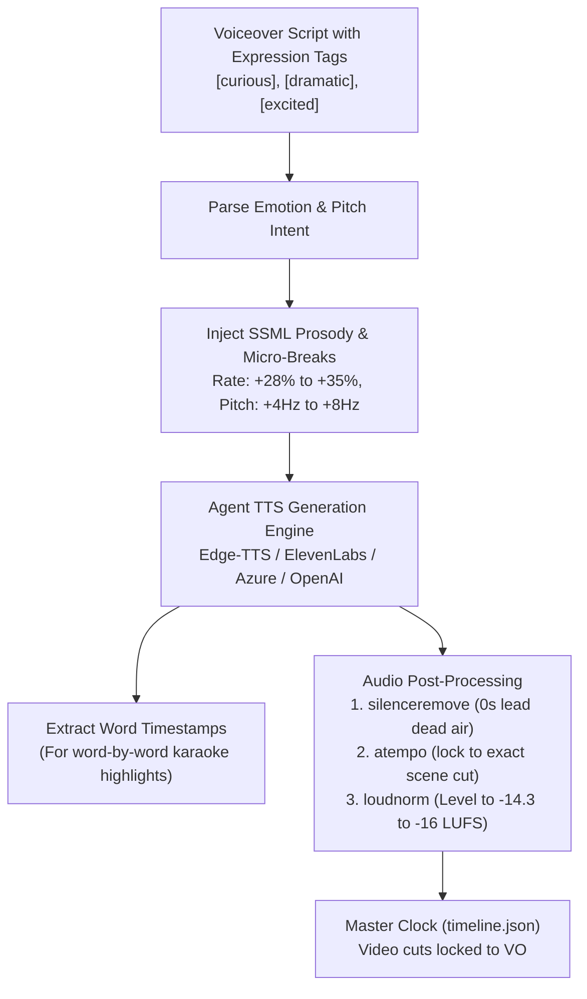
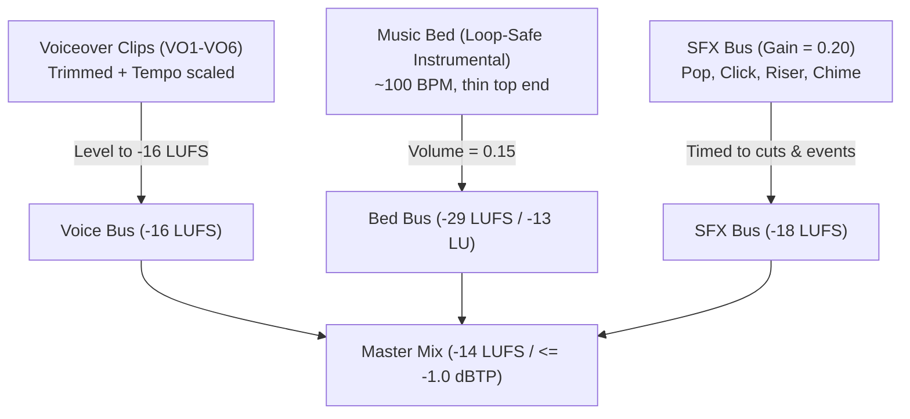

# Voice, Audio & Presenter Cutout Specification Guide (v7 Standard)

This guide defines the exact production contract for **Voiceover Direction**, **Agent TTS Execution**, **Master Audio Engineering**, and **Presenter Cutout Architecture** for any agent or creator executing reels with the `editorial-reel-video` skill.

---

## 1. The Viral Voiceover Retention Blueprint (For Agents with Built-in TTS)

> [!IMPORTANT]
> **Why Standard TTS Fails on Reels:**
> Default TTS models speak at ~110–125 Words Per Minute (WPM) with flat, robotic pitch contours. On modern vertical platforms (Instagram Reels, TikTok, YouTube Shorts), viewers swipe away within **1.8 seconds** if the opening lacks vocal energy, urgency, and pitch variance.
>
> **The Viral Benchmark & Fix:**
> Benchmarking top viral tech reels (e.g. Uttam Bhartiya's 58.8s explainer at `https://youtube.com/shorts/4Rywx6wWSAI`), retention requires an ultra-punchy velocity of **200–215 WPM**, 200 words per 60s, micro-breaks under 140ms, and mean pitch around 185–195 Hz with terminal lifts.



---

## 2. Vocal Direction & SSML Translation Matrix

When the agent processes a script with expression tags, it must map each tag to the following viral pacing parameters and SSML templates:

| Expression Tag | Viral Vocal Cadence | Pitch & Dynamic Shift | Delivery Tone | SSML / TTS Parameter Injection | Presenter Pose Pairing |
| :--- | :--- | :--- | :--- | :--- | :--- |
| **`[curious]`** | Rapid opening (**210–220 WPM**), questioning terminal lift | Pitch `+8%` / `+6Hz`, intimate breath dynamic | Fascinating hook, conspiratorial, intriguing | `<prosody rate="+32%" pitch="+8%">...?</prosody>` | `p1_shrug.png` (raised palms, wide eyes) |
| **`[explaining]`** | Crisp, articulate (**195–205 WPM**), clear consonants | Resonant mid-range (~190Hz), steady cadence | Clear, authoritative, pedagogical, confident | `<prosody rate="+28%" pitch="+3%">...</prosody>` | `p4_chin.png` (chin tap) or `p3_present.png` |
| **`[dramatic]`** | Staccato drop (**175–185 WPM**), contrast beat | Pitch `-5%` / drop to chest voice, breath pause | Intense, weighty revelation, high contrast | `<break time="120ms"/><prosody rate="+18%" pitch="-4%">...</prosody>` | `p8_point.png` or `p2_facepalm.png` |
| **`[confident]`** | Forward-driving clip (**205–215 WPM**), decisive | Upward terminal inflection, resonant, smiling | Authoritative, convincing, reassuring | `<prosody rate="+30%" pitch="+4%">...</prosody>` | `p3_present.png` (chest out, ta-da) |
| **`[excited]`** | High velocity burst (**215–230 WPM**), punchy noun stress | Higher pitch `+10%`, expansive dynamic range | Thrilled, electrifying, triumphant | `<prosody rate="+35%" pitch="+8%">...</prosody>` | `p6_thumbs.png` (big thumbs up, huge grin) |
| **`[playful]` / `[laughing]`** | Casual banter (**200–210 WPM**), breath chuckle | Relaxed cadence, cheerful vocal fry, smile | Friendly, peer-to-peer, cheeky | `<prosody rate="+30%" pitch="+5%">...</prosody>` *(with breath pause)* | `p7_cta.png` (pointing at viewer, wink) |

---

## 3. Presets for Common Agent TTS Engines

### A. Microsoft Edge-TTS / Azure Cognitive Speech (Free & Neural)
- **Hinglish / Hindi Recommended Voices**: `hi-IN-MadhurNeural` (male, energetic, articulate), `hi-IN-SwaraNeural` (female, friendly, clear).
- **English Recommended Voices**: `en-US-ChristopherNeural` (tech creator tone), `en-US-GuyNeural` (confident, conversational).
- **Command / Code Template**:
  ```python
  import edge_tts

  # Rate +30% locks into 200–215 WPM viral explainer cadence
  communicate = edge_tts.Communicate(
      text=script_text,
      voice="hi-IN-MadhurNeural",
      rate="+30%",
      pitch="+5Hz"
  )
  await communicate.save("assets/vo/vo1.mp3")
  ```

### B. ElevenLabs TTS Engine
- **Voice Archetypes**: Conversational tech explainer (e.g., *Adam*, *Antoni*, or *Josh*).
- **Settings for High Retention**:
  - `speed: 1.30` (scales baseline ~160 WPM delivery to ~208 WPM).
  - `stability: 0.32` (lower stability creates more natural human pitch variance and emotion).
  - `similarity_boost: 0.85` (high clarity on technical jargon).
  - `style: 0.50` (amplifies emotional expression tags).
  - `use_speaker_boost: true`

### C. OpenAI Audio TTS Engine
- **Voices**: `alloy` (balanced, clean) or `echo` (warm, articulate).
- **Speed Multiplier**: Always set `speed=1.30` to match 200–215 WPM viral delivery.

---

### D. Benchmark Reference: Viral Tech Reel Acoustic Analysis
Analysis of reference video (`https://youtube.com/shorts/4Rywx6wWSAI`):
- **Total Duration**: 58.82 seconds
- **Word Count**: 200 words (~204 WPM overall)
- **Inter-Sentence Pauses**: Mean 0.41s, Median 0.44s; in-sentence micro-pauses 100–140ms
- **Loudness**: `-14.3 LUFS` integrated, `3.4 LU` loudness range
- **Pitch Profile**: F0 mean 191 Hz, dynamic range 95 Hz to 300 Hz peak inflection

## 4. Word-Level Timestamps for Karaoke Captions

If the agent's TTS engine supports word boundaries (e.g. Edge-TTS word events, ElevenLabs timestamp alignment, or Whisper), the agent should output word metadata:

```json
{
  "section": "vo1",
  "words": [
    { "word": "Bhai,", "start": 0.35, "end": 0.62 },
    { "word": "kabhi", "start": 0.64, "end": 0.88 },
    { "word": "socha", "start": 0.90, "end": 1.15 },
    { "word": "hai", "start": 1.17, "end": 1.30 },
    { "word": "Tor", "start": 1.35, "end": 1.62 },
    { "word": "Browser", "start": 1.65, "end": 2.10 }
  ]
}
```
In the HTML composition, the active word receives class `.word-active`:
```css
.word-active {
  color: #FFE600; /* Bright Neon Yellow */
  transform: scale(1.14);
  display: inline-block;
  transition: transform 0.08s ease, color 0.08s ease;
}
```

---

## 5. Master Audio Engineering Standards

The audio mix must be clean, intelligible on smartphone speakers, and comply with broadcast/social loudness standards.



### The Seven Audio Rules

1. **The Voiceover is the Clock**:
   - Pictures cut to the voice, never the reverse.
   - Run `process_vo.py`: trim lead/tail silence with `silenceremove`, calculate duration. If script specifies exact timestamps (e.g. 60.0s), scale speed with FFmpeg `atempo` (max 1.40x).
2. **VO Loudness Target**:
   - Every voice clip is leveled to **`-16 LUFS`** with True Peak limit **`-1.5 dBTP`**:
     ```bash
     ffmpeg -i input.wav -af "loudnorm=I=-16:TP=-1.5:LRA=7" -ar 48000 -ac 2 out.wav
     ```
3. **The Music Bed (The Gap Filler)**:
   - Must be **instrumental only** (zero vocals) and **loop-safe** (1–2 bar groove with no dramatic key changes).
   - Volume set to **`0.15`** (`-16.5 dB`), measuring **`-29.0 LUFS`** in the mix — exactly **13 LU below the voice**.
   - **Zero sidechain ducking**: At a 13 LU gap, ducking causes unnatural pumping. The level gap *is* the duck.
   - Fade-in: `0.8s`, Fade-out: `1.6s` (fade must finish before video ends).
4. **Sound Effects (SFX) as Punctuation**:
   - **`pop.wav`**: Fired on **every scene cut** at `gain = 0.50`.
   - **`riser.wav`**: Fired **`0.30s` before the 2 biggest scene turns** at `gain = 0.28`.
   - **`click.wav` / `key.wav`**: Fired on diagram node hops / list row landings at `gain = 0.40`.
   - **`chime.wav`**: Fired on core revelation / scorecard display at `gain = 0.38`.
   - **`notify.wav` / `ping.wav`**: Fired on final CTA at `gain = 0.35`.
5. **SFX Offset Contract**:
   - SFX offsets are **relative to voice clips** (`"vo2+0.15"`), so re-recorded audio never breaks the sound design.
   - Never land a tick directly on a word's first syllable; land SFX **20–60 ms after** visual impact.
6. **Master Output Standard**:
   - Master audio: **`-14 LUFS` integrated**, True Peak **`<= -1.0 dBTP`**, 48,000 Hz, 192 kbps AAC stereo.
7. **Lead-in & Tail Safety**:
   - Lead-in: `0.30s – 0.35s` before first word.
   - Outro Tail: `1.15s – 1.60s` after last word to allow the music fade to complete cleanly.

---

## 6. Presenter Cutout Architecture (Anchor 5)

The presenter creates the personal human connection in every scene. The presenter is bottom-fixed and cropped by the frame, ensuring consistency across all scenes.

### The 9-Pose Matrix & Expression Mapping

| Pose File | Visual Description | Emotional Tag | Scene Placement |
| :--- | :--- | :--- | :--- |
| `p1_shrug.png` | Both palms open & raised in exaggerated shrug, shoulders hunched, excited grin | `[curious]` | Scene 1 (The Hook) |
| `p2_facepalm.png` | One palm flat against forehead, grimacing, eyes squeezed shut | `[frustrated]` | Problem / Pain Point |
| `p3_present.png` | Both arms open wide in proud "ta-da", chest out, big confident smile | `[confident]`, `[proud]` | Core Reveal / Solution |
| `p4_chin.png` | Index finger tapping chin, head tilted, sly half-smile | `[explaining]` | Technical Breakdown |
| `p5_memory.png` | Hand scratching back of head, small "aha" smile | `[recalling]`, `[analogy]` | Story / Everyday Analogy |
| `p6_thumbs.png` | Big thumbs up beside cheek, other hand pointing off, thrilled grin | `[excited]` | Proof / Numbers / Benchmark |
| `p7_cta.png` | Pointing index finger at viewer, playful cheeky grin, other thumb up | `[playful]`, `[laughing]` | Scene 6 (Call to Action) |
| `p8_point.png` | Pointing direct finger off-screen toward the diagram card | `[dramatic]`, `[look]` | Critical Detail Callout |
| `p9_idea.png` | Finger pointing straight up, lightbulb realization, wide eyes | `[revelation]`, `[idea]` | Pro Tip / Secret Hack |

### Presenter Grid Placement Rules (Invariant)
1. **Vertical Anchor**: `presenterTop = 0.634` (63.4% of frame height, or `1217px` on a `1080x1920` frame).
2. **Horizontal Anchor**: Right-aligned, `20.7%` from frame edge (`presenterX = 0.207`).
3. **Bottom Crop Rule**: `presenterTop + h > 1.0`. The character's waist must be sliced off cleanly by the bottom edge of the frame.
4. **Collision Rule**: The top of the presenter's head must never cross above `chipBottom` (`presenterTop >= chipBottom`).
5. **Adaptive Halo Glow**: The cutout has a subtle 18px colored halo (`drop-shadow: 0 0 24px rgba(..., 0.35)`) dynamically matching the scene's field color.
6. **Entrance Motion**: Soft pop-up from bottom (`fromY: 40px`, `fromScale: 0.94`, `duration: 0.34s`, `power3.out`).

---

## 7. How to Generate & Matte Cutout Poses

To maintain a consistent character across all 9 poses without facial drift:

### Step 1: Base Character Prompt
```text
Painterly anime-style illustration, semi-realistic webtoon rendering. Waist-up portrait of a young Indian man, early 20s. Warm tan skin with soft blush, broad open friendly smile with visible white teeth, large dark-brown eyes with white catchlights, thick expressive eyebrows, oval face, small painted nose. Extremely voluminous messy black hair with blue-black highlight strands, tousled spikes, swept forelock, sideburns meeting the ear. Oversized dark slate-navy hoodie with kangaroo pocket, drop shoulders, hood bunched behind the neck, drawstrings with coral-red tips, painted fabric folds. Soft two-tone shading: warm key light upper left, cool rim light on hair and shoulder. Crisp clean outer silhouette. Solid pure white background, no text, no logo, three-quarter view, cropped at the waist, hands visible and expressive. POSE: presenting with open palm toward his left, other hand relaxed at his side, chin slightly up, confident.
```

### Step 2: Pose Edits (Reference-Only)
Feed the base image back as image reference and swap ONLY the final pose sentence:
```text
Same character, same painterly anime webtoon style, same oversized dark slate-navy hoodie with coral-red drawstring tips, same voluminous messy black hair, same warm two-tone lighting, same solid pure white background, same waist-up crop. Keep his face, hair and outfit identical to the reference. Change ONLY the pose and expression: [INSERT POSE DESCRIPTION FROM MATRIX]
```

### Step 3: Matte & Clean via `scripts/cutout.py`
Run the automated alpha-matting script:
```bash
python scripts/cutout.py
```
This script:
1. Flood-fills border-connected pure white (`RGB >= 243`).
2. Erodes the subject mask by `1px` to permanently destroy white fringe halos.
3. Feathers the edge by `0.8px` Gaussian blur.
4. Crops transparent bounds and normalizes height to `1200px` for uniform placement math.

---

## 8. Summary Checklist for Any Executing Agent

1. **Parse Script**: Extract emotion tags (`[curious]`, `[explaining]`, `[dramatic]`, etc.).
2. **Generate Voiceover**:
   - Inject SSML prosody (`rate: +15%`, `pitch: +4Hz to +8Hz`).
   - Strip silence with `silenceremove`.
   - Scale tempo with `atempo` to hit designated time budget.
   - Level with `loudnorm=I=-16:TP=-1.5:LRA=7`.
3. **Map Cutout Poses**: Pair `[curious]` ➔ `p1_shrug.png`, `[explaining]` ➔ `p4_chin.png`, etc.
4. **Construct 5-Anchor Invariant Grid**: Kicker ➔ Hero ➔ Proof Card ➔ Chip ➔ Presenter.
5. **Cycle 6 Background Fields**: `accent → ground → ink → secondary → tertiary → quaternary`.
6. **Apply Skewed Dual-Band Wipes**: `-11deg` angled sweep between every scene cut.
7. **Master Soundtrack**: Level bed at `-29 LUFS`, trigger `pop.wav` on all cuts, export at `-14 LUFS`.
